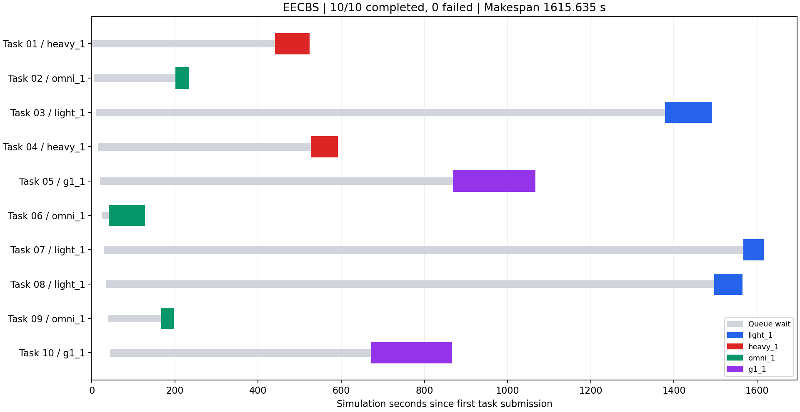

# 副本 A：十任务连续仿真验证与指标

本报告来自修复后从初始车位启动的一次独立 Gazebo 批次。十项任务保持原 ID、任务参数与提交顺序，未中途重启调度器、手动移车、重新命名补跑或合并旧批次。

场景：`src/hetero_fleet_scheduler/config/tasks/demo_10.yaml`。所有四套 Nav2 的规划器、控制器、导航器生命周期激活后，使用原任务发布器按 `--interval 8` 提交。

## 汇总

| 指标 | 结果 |
|---|---|
| 提交／完成／失败 | 10／10／0 |
| 完成率 | 100% |
| Makespan | 1355.146 秒 |
| 平均任务完成时间（提交至完成） | 667.672 秒 |
| 平均排队等待（提交至派单） | 584.808 秒 |
| 平均执行时间（派单至完成） | 82.864 秒 |
| 调度器统计总里程 | 189.776 米 |
| 模型估算总能耗 | 319.967 Wh |
| 车队平均任务利用率 | 15.29% |
| 重排次数 | 19 |
| 任务重新入队次数 | 0 |
| 超期任务 | 0 |
| 验证墙钟耗时（提交至指标落盘） | 2630.1 秒 |

除墙钟耗时外，时间指标均采用仿真时间。Makespan 从本批次首项任务提交算到最后一项完成；平均完成时间包含排队。总里程与能耗为项目调度器的统计及估算，能耗来自车型、载荷与里程模型，不是电表测量。空驶和已计入的让位/返航会影响车队总量；最后完成后的返航不计入 Makespan。

利用率为四台机器人的任务忙碌时间之和除以 `4 × Makespan`，不把让位、返航算作任务忙碌时间。单次成功运行证明该场景能够执行完成，不构成最优 Makespan 或相对旧方法提升的证明。

## 最终返航后累计值

四台机器人均已空闲，待执行与执行中的搬运任务均为 0；位姿满足项目原有 0.35 米停车到位判据。下面的里程、能耗包含最后一项任务结束后的最终返航，与上面“十项任务完成时”的采样区分。

| 指标 | 返航后结果 |
|---|---:|
| 统计总里程 | 198.456 米 |
| 估算总能耗 | 327.344 Wh |
| light / heavy / omni / G1 完成任务数 | 3 / 2 / 3 / 2 |
| Makespan | 1355.146 秒（不受结束后返航影响） |

主要等待集中在 light 的三项任务；平均派单前等待 584.808 秒，高于平均派单后执行 82.864 秒。当前互斥通道、让位和返航的衔接仍有优化空间，本次证明该场景可连续完成，不宣称调度性能已经最优。

## 每台机器人（十任务完成时）

| 机器人 | 完成任务 | 统计里程 m | 估算能耗 Wh | 任务忙碌 s | 电量 % |
|---|---:|---:|---:|---:|---:|
| light_1 | 3 | 53.661 | 49.103 | 226.209 | 86.6 |
| heavy_1 | 2 | 44.574 | 119.776 | 140.531 | 88.9 |
| omni_1 | 3 | 47.313 | 61.325 | 152.080 | 88.2 |
| g1_1 | 2 | 44.228 | 89.762 | 309.820 | 50.1 |

## 十项任务

| 任务 | 机器人 | 等待 s | 执行 s | 提交至完成 s | 统计里程 m | 估算能耗 Wh |
|---|---|---:|---:|---:|---:|---:|
| balanced_10_01 | heavy_1 | 430.946 | 80.198 | 511.144 | 20.366 | 61.082 |
| balanced_10_02 | omni_1 | 160.146 | 32.480 | 192.626 | 8.942 | 12.155 |
| balanced_10_03 | light_1 | 1112.996 | 111.716 | 1224.712 | 29.153 | 25.898 |
| balanced_10_04 | heavy_1 | 332.174 | 60.333 | 392.507 | 14.773 | 41.713 |
| balanced_10_05 | g1_1 | 691.011 | 187.353 | 878.364 | 13.595 | 27.467 |
| balanced_10_06 | omni_1 | 13.765 | 89.218 | 102.983 | 10.701 | 15.263 |
| balanced_10_07 | light_1 | 1276.866 | 48.201 | 1325.067 | 8.181 | 7.786 |
| balanced_10_08 | light_1 | 1201.893 | 66.292 | 1268.185 | 9.627 | 9.724 |
| balanced_10_09 | omni_1 | 90.706 | 30.382 | 121.088 | 5.752 | 9.797 |
| balanced_10_10 | g1_1 | 537.572 | 122.467 | 660.039 | 19.115 | 39.259 |

## 修复与验证

- 为让位使用独立到位容差，G1 等待点下移至 `(1.2, -1.08)`，完整车身静态碰撞检查通过；实际到位后才允许任务派发。
- 不可达反馈在同一物理场景保留 60 秒，避免 8 秒内失效导致反复选择被堵任务；车辆移动超过 0.08 米或转动超过 0.15 弧度时立即失效，正常可达路径仍只缓存 8 秒。
- omni 西侧等待位按 heavy/G1 工作是否结束释放，经真实 Nav2 路径检查返回东侧，为 light 腾出出口。返航保留串行准入与逐段完整车身预检。
- 返航车辆等待通道时释放返航名额，让物理占用者先撤离，恢复返航前重新申请；退让点避开已派任务的取送点，任务变化时动态取消不合适的退让。
- 保留车型尺寸、地图与安全检查，禁用导航不可用时的运动学模拟。任务取送点继续要求新鲜实际位姿在 0.15 米范围内。
- 320 项 Python 检查、6 个原生场景及 3 项控制器恢复检查通过。构建和原目录完整性检查的最终结果见 `副本A验证记录.json`。

